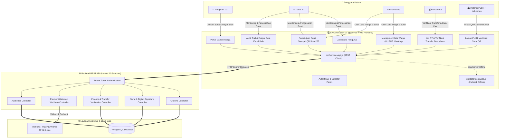

# 🏘️ SAPA WARGA 07 (SI-WARGA 07)
### Sistem Informasi & Pelayanan Administrasi Digital Warga RT 007 / RW 030
**Kelurahan Teluk Pucung, Kecamatan Bekasi Utara, Kota Bekasi**

---

<p align="center">
  
  
  
  
  
  
  
  
</p>

---

## 📖 Daftar Isi
1. [Tentang Aplikasi](#-tentang-aplikasi)
2. [Fitur Unggulan](#-fitur-unggulan)
3. [Arsitektur Sistem & Alur Aliran Data](#-arsitektur-sistem--alur-aliran-data)
4. [Matriks Peran & Hak Akses (Role-Based Access)](#-matriks-peran--hak-akses-role-based-access)
5. [Keamanan & Kepatuhan Regulasi (UU PDP)](#-keamanan--kepatuhan-regulasi-uu-pdp)
6. [Struktur Direktori Proyek](#-struktur-direktori-proyek)
7. [Panduan Instalasi & Menjalankan Aplikasi](#-panduan-instalasi--menjalankan-aplikasi)
8. [Akun Uji Coba Cepat (Demo Credentials)](#-akun-uji-coba-cepat-demo-credentials)
9. [Integrasi Layanan & Spesifikasi API](#-integrasi-layanan--spesifikasi-api)
10. [Fitur Ekspor & Pelaporan Data](#-fitur-ekspor--pelaporan-data)
11. [Kontak & Dukungan Lingkungan](#-kontak--dukungan-lingkungan)

---

## 📌 Tentang Aplikasi

**SAPA WARGA 07** adalah platform web modern untuk digitalisasi pelayanan administrasi warga, transparansi tata kelola kas rukun tetangga, dan otomasi pengurusan surat pengantar di lingkungan **RT 007 / RW 030 Kelurahan Teluk Pucung, Kecamatan Bekasi Utara**.

Aplikasi ini mengadopsi arsitektur **Dual-Mode** yang fleksibel:
1. **Mode Terhubung (Live REST API)**: Terhubung langsung ke backend server Laravel 10 (`warga-be`) dengan basis data relasional PostgreSQL dan autentikasi Laravel Sanctum Bearer token.
2. **Mode Cadangan Mandiri (Offline Mock Fallback)**: Mampu berjalan secara mandiri tanpa backend server dengan dataset simulasi kependudukan yang realistis, memudahkan demonstrasi (*showcase*) dan pengujian antarmuka tanpa dependensi server aktif.

---

## 🚀 Fitur Unggulan

### 1. 📜 Pelayanan Surat Pengantar Digital & Validasi QR Code SHA-256
- **Pengajuan Mandiri 24/7**: Warga dapat mengajukan berbagai jenis surat pengantar (SKCK, Pembuatan/Perpanjangan KTP, Surat Keterangan Domisili, Surat Keterangan Usaha/UMKM, Pengantar Nikah, SKTM, dsb.).
- **Persetujuan & Penolakan Transparan**: Pengurus dapat menyetujui surat dalam satu klik atau menolak dengan catatan alasan perbaikan yang langsung muncul pada portal warga dengan opsi *Perbaiki & Ajukan Ulang*.
- **Cetak Surat Berformat Resmi**: Layout cetak standar pemerintah tingkat RT lengkap dengan kop surat resmi, stempel digital, dan tanda tangan Ketua RT.
- **Verifikasi Publik Keaslian Surat via QR Code**: Setiap surat pengantar yang disetujui dilengkapi QR Code unik berbasis hash token SHA-256. Pihak kelurahan, kepolisian, atau instansi terkait dapat memindai QR Code tersebut untuk membuka laman verifikasi resmi tanpa risiko manipulasi dokumen.

### 2. 💳 Ekosistem Pembayaran Iuran Modern (Multi-Channel)
- **Transfer Bank Langsung & Upload Bukti**: Transfer ke rekening kas RT (BCA & Bank Mandiri) dengan unggah struk m-banking/ATM.
- **Verifikasi Bukti Transfer Eksklusif Bendahara**: Fitur modal pemeriksaan struk digital resolusi tinggi, tombol verifikasi instan yang langsung membukukan kas masuk, serta tombol tolak bukti transfer dengan catatan alasan.
- **Payment Gateway Otomatis (Midtrans / Tripay)**: Dukungan Dynamic QRIS (GoPay, OVO, Dana, ShopeePay, LinkAja, BCA, Mandiri) dan Virtual Account dengan webhook callback instan.
- **Setor Tunai Terjadwal via WhatsApp**: Warga yang memilih pembayaran tunai langsung ke rumah Bendahara RT dapat mengirim pesan konfirmasi WhatsApp yang digenerate otomatis.
- **Kuitansi Digital Otomatis**: Bukti pembayaran resmi terbit secara otomatis dan dapat diunduh/dicetak oleh warga kapan saja.

### 3. 👥 Manajemen Kependudukan & Pelindungan Data Pribadi (UU PDP No. 27/2022)
- **Data Master Penduduk & Mutasi**: Pencatatan warga tetap, domisili/kontrak, mutasi lahir, wafat, pindah, dan datang.
- **Data Masking Otomatis**: Sensor privasi otomatis untuk NIK (`327501******0001`), No. KK, dan No. HP pada tampilan antarmuka.
- **Role-Based Reveal**: Tombol toggle untuk membuka sensor identitas hanya bagi pengurus yang berwenang.

### 4. 💰 Pembukuan Kas & Akuntabilitas Finansial
- **Buku Kas Operasional RT**: Pencatatan transaksi pemasukan dan pengeluaran kas dengan kategori terstandar dan kalkulasi saldo kas *real-time*.
- **Matriks Status Iuran Bulanan**: Monitoring riwayat iuran 12 bulan warga tahun berjalan dengan status visual *Lunas* atau *Belum Lunas*.
- **Prinsip Segregation of Duties**: Pemisahan wewenang yang tegas di mana Ketua RT dan Sekretaris tidak memiliki akses memvalidasi bukti pembayaran demi menegakkan integritas akuntansi.

### 5. 🛡️ Audit Trail & Jejak Aktivitas Komprehensif
- **Perekaman Log Menyeluruh**: Setiap aksi penambahan/pengubahan data warga, pencatatan mutasi kas, persetujuan/penolakan surat, callback payment gateway, hingga aktivitas login tercatat lengkap beserta timestamp, IP Address, perangkat, dan aktor pelaksana.
- **Filter Multi-Kriteria**: Penyaringan log berdasarkan modul, jenis aksi (CREATE, UPDATE, DELETE, APPROVE, REJECT, PAYMENT_CALLBACK), dan peran aktor.

### 6. 📊 Ekspor Data Excel-Safe (CSV UTF-8 BOM)
- Ekspor data kependudukan, buku kas ledger, matriks iuran warga, dan audit log ke format CSV dengan enkoding UTF-8 BOM.
- Kolom angka panjang seperti NIK dan No. KK diformat dengan proteksi teks Excel (`="""..."""`) sehingga tidak rusak menjadi notasi ilmiah (`3.27501E+15`) saat dibuka di Microsoft Excel.

---

## 📐 Arsitektur Sistem & Alur Aliran Data



---

## 👥 Matriks Peran & Hak Akses (Role-Based Access)

| Modul & Fungsionalitas | 👑 Ketua RT | ✍️ Sekretaris | 💰 Bendahara | 👤 Warga RT |
| :--- | :---: | :---: | :---: | :---: |
| **Dashboard Statistik & Ringkasan RT** | ✅ | ✅ | ✅ | ❌ |
| **Kelola Master Kependudukan & Mutasi** | ✅ | ✅ | ❌ | ❌ |
| **Masking / Unmasking Data Sensitif UU PDP** | ✅ | ✅ | ❌ | ❌ |
| **Persetujuan & Penolakan Surat Pengantar** | ✅ *(Pengesah)* | ✅ *(Reviewer)* | ❌ *(Dibatasi)* | ❌ |
| **Pengajuan Surat Pengantar Mandiri** | ❌ | ❌ | ❌ | ✅ |
| **Pencatatan Pemasukan & Pengeluaran Kas** | ❌ *(View Only)* | ❌ *(View Only)* | ✅ *(Full Akses)* | ❌ |
| **Verifikasi Struk Transfer Pembayaran Warga** | ❌ *(Segregation)* | ❌ *(Segregation)* | ✅ *(Eksklusif)* | ❌ |
| **Pembayaran Iuran (QRIS / Transfer / Tunai)** | ❌ | ❌ | ❌ | ✅ |
| **Manajemen Pengumuman & Agenda Lingkungan** | ✅ | ✅ | ❌ | ❌ *(View Only)* |
| **Manajemen Pengguna & Akun Pengurus** | ✅ | ❌ | ❌ | ❌ |
| **Audit Trail & Ekspor Seluruh Laporan CSV** | ✅ | ✅ | ✅ *(Kas Only)* | ❌ |
| **Verifikasi Keaslian Surat via QR Code** | ✅ | ✅ | ✅ | ✅ *(Publik)* |

> [!NOTE]
> **Prinsip Segregation of Duties (Pemisahan Wewenang Keuangan):**
> Ketua RT dan Sekretaris secara arsitektural tidak diberi akses memverifikasi bukti transfer atau mengubah saldo kas. Hak tersebut secara eksklusif didelegasikan kepada Bendahara RT untuk menjamin akuntabilitas serta mencegah konflik kepentingan dalam pengelolaan dana warga.

---

## 🔒 Keamanan & Kepatuhan Regulasi (UU PDP)

SAPA WARGA 07 dirancang dengan kepatuhan terhadap **Undang-Undang Republik Indonesia Nomor 27 Tahun 2022 tentang Pelindungan Data Pribadi (UU PDP)**:

1. **Penerapan *Privacy-by-Default* (Data Masking)**:
   - Data kependudukan berupa NIK, No. Kartu Keluarga, dan Nomor Handphone warga secara otomatis disensor pada antarmuka publik dan tabel operasional pengurus.
   - Pola sensor: NIK `327501******0001` (hanya menampilkan 6 digit kode wilayah dan 4 digit unik akhir).
2. **Integritas Dokumen Digital (SHA-256 Cryptographic Hash)**:
   - Setiap surat pengantar yang diterbitkan memuat token verifikasi kriptografi 32-karakter unik.
   - Pihak pemeriksa dokumen dapat mengakses route verifikasi publik `?verify={token}` atau `/verifikasi-surat/{token}` untuk mencocokkan data fisik dengan arsip asli digital.
3. **Ekspor Data Terlindungi dari *CSV Injection* / *Scientific Corruption***:
   - Angka NIK dan No. KK berpanjang 16 digit dibungkus dengan formula teks aman agar tidak berubah menjadi format notasi eksponensial di aplikasi spreadsheet.
4. **Keamanan Autentikasi**:
   - Mendukung standar Bearer Token HTTP Authorization header dengan penyimpanan aman di sisi klien.

---

## 📂 Struktur Direktori Proyek

```plaintext
warga-fe/
├── public/
│   └── vite.svg                      # Favicon aplikasi
├── src/
│   ├── assets/
│   │   ├── hero.png                  # Ilustrasi visual header portal warga
│   │   ├── react.svg
│   │   └── vite.svg
│   ├── components/
│   │   ├── auth/
│   │   │   └── LoginPage.jsx         # Halaman login dual-tab (Pengurus & Warga) + Demo fast login
│   │   ├── modals/
│   │   │   ├── SuratPrintModal.jsx   # Pratinjau surat resmi siap cetak + kop RT & QR Code
│   │   │   └── TambahWargaModal.jsx  # Form modal tambah/edit warga (validasi NIK & KK)
│   │   ├── views/
│   │   │   ├── AuditLogView.jsx      # Panel audit trail jejak aktivitas pengurus & sistem
│   │   │   ├── DashboardView.jsx     # Visualisasi KPI kependudukan, iuran & kas
│   │   │   ├── DataWargaView.jsx     # Tabel master warga, mutasi & filter kependudukan
│   │   │   ├── InformasiView.jsx     # Manajemen pengumuman & agenda kegiatan warga
│   │   │   ├── KeuanganView.jsx      # Buku kas operasional, verifikasi transfer & iuran
│   │   │   ├── PublicSuratVerifyView.jsx # Halaman publik pembuktian keabsahan surat via QR
│   │   │   ├── SettingsView.jsx      # Pengaturan akun pengurus & profil lingkungan RT
│   │   │   ├── SuratView.jsx         # Arsip pengajuan surat, persetujuan & form alasan penolakan
│   │   │   └── WargaPortalView.jsx   # Portal mandiri warga: pengajuan surat & pembayaran iuran
│   │   ├── Footer.jsx                # Komponen footer aplikasi & kontak darurat
│   │   ├── Header.jsx                # Header bar, indikator koneksi backend & profil aktif
│   │   └── SidebarDrawer.jsx         # Navigasi sidebar responsif pengurus
│   ├── data/
│   │   ├── auditLogData.js           # Dataset riwayat audit trail awal
│   │   └── mockData.js               # Master mock dataset (penduduk, transaksi kas, surat, user)
│   ├── services/
│   │   └── api.js                    # HTTP Client REST API Laravel terpusat
│   ├── utils/
│   │   ├── exportUtils.js            # Generator ekspor CSV dengan UTF-8 BOM & Text Formula
│   │   └── privacyUtils.js           # Utilitas masking NIK, KK, dan No. HP sesuai UU PDP
│   ├── App.css
│   ├── App.jsx                       # Komponen root, router state & auto sync backend
│   ├── index.css                     # Desain sistem responsif, variabel tema & print style
│   └── main.jsx                      # Bootstrap aplikasi Vite React
├── .env                              # Variabel lingkungan aktif
├── .env.example                      # Contoh berkas konfigurasi lingkungan
├── .gitignore
├── .oxlintrc.json                    # Aturan linter performa Oxlint
├── index.html                        # Root HTML & konfigurasi viewport
├── package.json                      # Daftar dependensi & script runner
├── README.md                         # Dokumentasi teknis proyek
└── vite.config.js                    # Konfigurasi bundler Vite
```

---

## ⚡ Panduan Instalasi & Menjalankan Aplikasi

### 1. Prasyarat Sistem
- **Node.js**: Versi `18.x` atau yang lebih baru (disarankan `Node.js 20 LTS`).
- **NPM** atau **Yarn / PNPM / Bun**.
- **Peramban Web Modern**: Google Chrome, Mozilla Firefox, Microsoft Edge, atau Safari versi terbaru.

### 2. Klon Repositori
```bash
git clone https://github.com/ayunisay/warga-fe.git
cd warga-fe
```

### 3. Pasang Seluruh Dependensi
```bash
npm install
```

### 4. Konfigurasi Variabel Lingkungan (`.env`)
Salin berkas `.env.example` menjadi `.env`:
```bash
cp .env.example .env
```
Isi konfigurasi endpoint backend API Anda:
```env
# Alamat Backend REST API (Laravel 10 warga-be)
VITE_API_URL=http://127.0.0.1:8001/api
```

> [!TIP]
> **Mode Tanpa Backend (Offline Showcase):**
> Jika backend `warga-be` belum dijalankan, Anda tetap dapat menjalankan aplikasi frontend secara langsung. Sistem secara otomatis mendeteksi ketiadaan server dan menggunakan dataset tiruan (*mock data*) tanpa memunculkan layar putih atau crash.

### 5. Jalankan Server Pengembangan (Development Server)
```bash
npm run dev
```
Setelah server berjalan, buka peramban dan akses alamat yang tertera pada konsol terminal:
```text
  VITE v8.3.0  ready in 240 ms

  ➜  Local:   http://localhost:5173/
  ➜  Network: use --host to expose
```

### 6. Menjalankan Pengecekan Kode (Linting)
Proyek ini menggunakan **Oxlint** untuk pengecekan kode berkecepatan tinggi:
```bash
npm run lint
```

### 7. Membangun Berkas Produksi (Production Build)
Untuk melakukan kompilasi berkas yang dioptimalkan sebelum deploy:
```bash
npm run build
```
Hasil kompilasi akan tersimpan di dalam direktori `dist/`. Anda dapat mengujinya secara lokal dengan perintah:
```bash
npm run preview
```

---

## 🔑 Akun Uji Coba Cepat (Demo Credentials)

Halaman login dilengkapi tombol **Demo Fast Login** untuk beralih peran hanya dengan satu kali klik tanpa perlu mengetik kredensial manual:

| Peran Akun | Nama Pejabat / Warga | NIK / Login | Password | Cakupan Wewenang Utama |
| :--- | :--- | :--- | :--- | :--- |
| **👑 Ketua RT** | H. Bambang Sugiarto, S.T. | `3275011204850001` *(atau `ketua.rt007@gmail.com`)* | `password` | Superadmin RT, Pengesahan Surat, Audit Trail, Manajemen Pengguna |
| **✍️ Sekretaris** | Ahmad Fauzi, S.Kom. | `3275018809910008` *(atau `sekretaris.rt007@gmail.com`)* | `password` | Manajemen Data Warga, Review Permohonan Surat, Pengumuman |
| **💰 Bendahara** | Hj. Endang Suryaningsih | `3275016703800007` *(atau `bendahara.rt007@gmail.com`)* | `password` | Pembukuan Kas, Verifikasi Bukti Transfer Warga, Rekap Iuran |
| **👤 Warga 1 (Default)** | Andi Pratama | `3275012301900003` *(Blok B3 No. 12)* | `password` | Pengajuan Surat Pengantar, Bayar Iuran Mandiri, Kuitansi Digital |
| **👤 Warga 2** | Siti Aminah | `3275015506920004` *(Blok A1 No. 04)* | `password` | Portal Mandiri Warga RT 007 |
| **👤 Warga 3** | Budi Santoso | `3275011908880002` *(Blok C2 No. 08)* | `password` | Portal Mandiri Warga RT 007 |

---

## 🔌 Integrasi Layanan & Spesifikasi API

Frontend berkomunikasi dengan backend melalui modul terpadu [`src/services/api.js`](file:///c:/laragon/www/warga-fe/src/services/api.js) dengan endpoint terstandar:

| Modul | Method | Endpoint | Fungsi |
| :--- | :---: | :--- | :--- |
| **Autentikasi** | `POST` | `/api/login` | Login pengurus/warga & perolehan Bearer token |
| | `POST` | `/api/logout` | Revoke token sesi pengguna |
| | `GET` | `/api/user` | Mendapatkan data profil akun yang sedang login |
| **Kependudukan** | `GET` | `/api/citizens` | Mengambil seluruh data penduduk dengan parameter filter |
| | `POST` | `/api/citizens` | Menambahkan warga baru ke database |
| | `PUT` | `/api/citizens/:id` | Memperbarui data warga |
| | `DELETE` | `/api/citizens/:id` | Menghapus data kependudukan |
| | `PATCH` | `/api/citizens/:id/toggle-iuran` | Memperbarui status pembayaran iuran warga |
| **Keuangan Kas** | `GET` | `/api/transactions` | Rekapitulasi mutasi buku kas |
| | `POST` | `/api/transactions` | Mencatat transaksi kas masuk / kas keluar baru |
| | `GET` | `/api/transactions/summary` | Mengambil ringkasan saldo, total masuk, dan keluar |
| **Verifikasi Transfer** | `GET` | `/api/transfers` | Mengambil antrean bukti transfer warga |
| | `POST` | `/api/transfers/verify/:id` | Verifikasi terima atau tolak bukti transfer oleh Bendahara |
| **Payment Gateway** | `POST` | `/api/payments/charge` | Membuat tagihan pembayaran Dynamic QRIS / VA |
| | `GET` | `/api/payments/status/:orderId` | Memeriksa status settlement pembayaran |
| | `POST` | `/api/payments/simulate/:orderId` | Endpoint simulasi pembayaran (Sandbox / Dev) |
| **Surat Pengantar** | `GET` | `/api/surat` | Mengambil arsip permohonan surat warga |
| | `POST` | `/api/surat` | Pengajuan surat pengantar baru oleh warga |
| | `PATCH` | `/api/surat/:id/status` | Persetujuan atau penolakan surat oleh Ketua RT |
| | `GET` | `/api/surat/verify/:token` | Endpoint verifikasi keaslian surat untuk publik |
| **Pengumuman** | `GET` | `/api/announcements` | Mengambil daftar pengumuman & agenda kegiatan RT |
| | `POST` | `/api/announcements` | Publikasi agenda / pengumuman baru |
| | `DELETE` | `/api/announcements/:id` | Menghapus pengumuman |
| **Dashboard** | `GET` | `/api/dashboard/stats` | Mengambil agregat statistik eksekutif pengurus |

---

## 📑 Fitur Ekspor & Pelaporan Data

Seluruh data transaksi dan administrasi dapat diunduh langsung dari antarmuka web melalui utilitas [`src/utils/exportUtils.js`](file:///c:/laragon/www/warga-fe/src/utils/exportUtils.js):

1. **Ekspor Data Kependudukan (`exportCitizensToCsv`)**:
   - Menghasilkan daftar lengkap warga RT 007 dengan identitas, alamat blok/rumah, status kependudukan, dan nomor kontak.
2. **Ekspor Buku Kas Ledger (`exportKasLedgerToCsv`)**:
   - Menghasilkan laporan jurnal kas berkala lengkap dengan tanggal, kode referensi, sumber dana, kategori transaksi, nominal, dan saldo berjalan.
3. **Ekspor Matriks Iuran Warga (`exportIuranToCsv`)**:
   - Menghasilkan rekapitulasi setoran iuran per KK dari bulan Januari hingga Desember untuk keperluan rapat pertanggungjawaban RT.
4. **Ekspor Audit Trail (`exportAuditLogsToCsv`)**:
   - Menghasilkan log kepatuhan yang mencatat seluruh jejak audit pengurus untuk transparansi warga.

---

## 📞 Kontak & Dukungan Lingkungan

| Layanan Lingkungan | Penanggung Jawab | Narahubung / Saluran |
| :--- | :--- | :--- |
| **Ketua RT 007** | Bpk. H. Bambang Sugiarto, S.T. | Jl. Teluk Pucung Raya Blok B3 / WA: 0812-3456-7890 |
| **Sekretariat RT** | Sdr. Ahmad Fauzi, S.Kom. | Balai Warga RT 007 / WA: 0813-9876-5432 |
| **Bendahara Kas RT** | Ibu Hj. Endang Suryaningsih | Rumah Dinas Bendahara Blok A1 / WA: 0811-2233-4455 |
| **Pos Keamanan & Ronda** | Tim Satpam RT 007 (24 Jam) | Pos Utama Gerbang RT 007 / Emergency: (021) 8899-0077 |

---

<p align="center">
  <b>Hak Cipta © 2026 SAPA WARGA 07</b><br>
  Rukun Tetangga 007 / Rukun Warga 030, Kelurahan Teluk Pucung, Kecamatan Bekasi Utara, Kota Bekasi.<br>
  <i>Dikembangkan untuk kemajuan, kemudahan administrasi, dan transparansi warga.</i>
</p>
